# Config Guide

Everything an admin needs to put Time Drive on a record page and choose what it shows: what Time Drive is, how it works, and a walk through the setup wizard for each kind of source.

- [What Time Drive is](#what-time-drive-is)
- [What it does](#what-it-does)
- [How it works](#how-it-works)
- [Before you start](#before-you-start)
- [Time Drive Setup](#time-drive-setup)
- [Add a source](#add-a-source)
  - [A standard object](#a-standard-object)
  - [A junction object](#a-junction-object)
  - [A custom object](#a-custom-object)
  - [An Apex class](#an-apex-class)
- [Add the timeline to a page](#add-the-timeline-to-a-page)
- [Reference](#fit-to-your-org): Fit to your org, source fields, Data 360, Apex, scale, translations

## What Time Drive is

Time Drive is a timeline for Contact, Account and Lead record pages, person accounts included. It puts everything that happened with a customer in one place, in the order it happened: tasks, calls, emails, events, cases, opportunities, files, any standard or custom object, data from other systems through Apex, and Data 360 engagement.

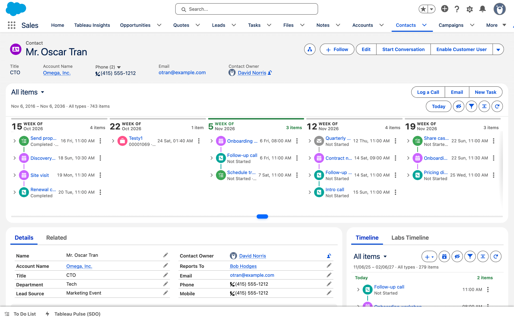

An admin chooses what each record page's timeline shows in **Time Drive Setup**, by answering a few plain questions. No code is needed, except for data Salesforce can't reach with a query.

## What it does

**Two layouts, one timeline.** In a wide region the timeline runs across the page: a column per day (or per week or month for long histories), with a seek bar to jump anywhere in the history. In a narrow region, such as the sidebar, it's a list, newest first, with a scrub tab on its edge.

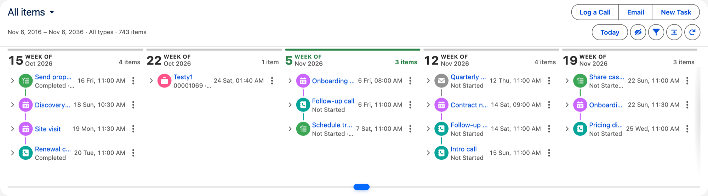

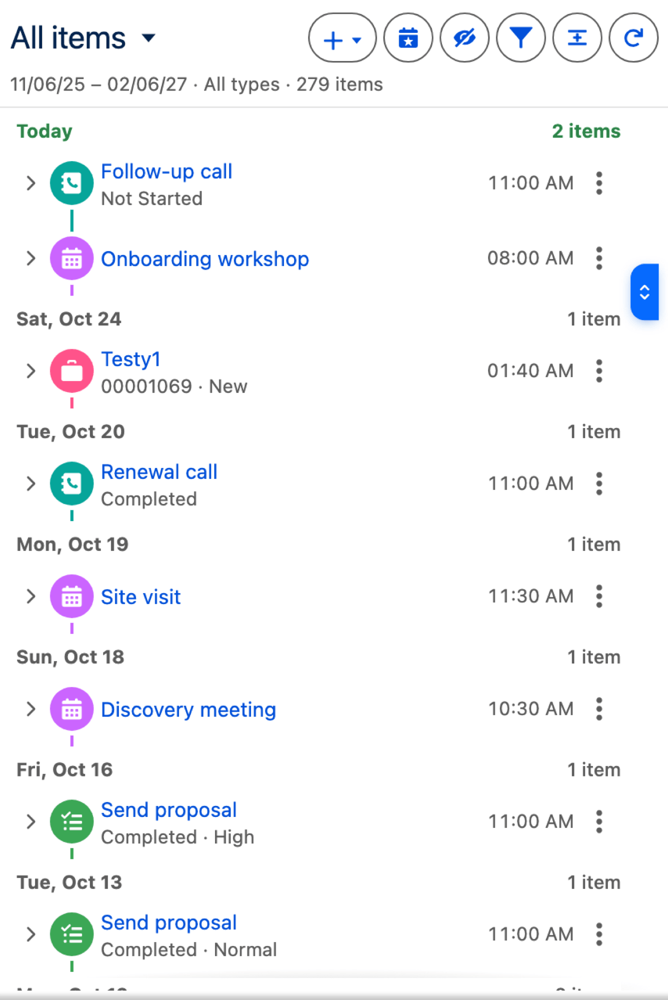

Along the top:

- **The lens**, the timeline's heading (All items, Sales, Service ...): a lens narrows the timeline to one area. People pick one from the heading, and Time Drive remembers their choice.
- **The summary line**: the date range, the types shown and how many items there are.
- **Today** brings today into view. **Overdue**, there only while something is overdue, opens the Overdue lens. **Filters** chooses event types and narrows the date range. The other buttons switch to titles only, expand every item, and refresh.

Each item shows its title, subtitle and time. Open one to see the fields the admin chose. Click its title to open its record. Its menu offers Edit and Delete, when the person may.

**Busy days stay readable.** A day with more than 50 items of a type shows one grouped row per type, with its count. For Salesforce sources its title opens **View all**, a list of every item behind it, loading as you scroll.

**Everyone sees only what they may.** Every query runs as the person looking, with their sharing and field access.

**Every language and locale.** Dates, times and numbers follow each person's locale and time zone. The timeline's text comes in 13 languages, and right-to-left languages mirror the card. See [Translations](#translations).

## How it works

A timeline is made of **sources**. A source answers four questions: which records (an object and how it links to the page's record), which date places each one, what each item says (its title, subtitle, icon and colour), and which lenses it's in. Sources are saved as **Time Drive Source** custom metadata records, so they move between orgs like any other metadata.

When a record page opens, Time Drive works in two steps, so even a record with years of history opens quickly:

1. **A summary first.** Each source is counted, not read: an aggregate query per object gives how many items fall on each day of the window (or each week or month, for long windows). The summary draws the day list, the overview bars and the totals.
2. **Then the days on screen.** Only the items for the days in view are read, a page at a time as people scroll. A busy day isn't read at all: it comes back as grouped counts.

So a timeline costs about the same whether the record has a hundred items or a million.

Three kinds of source supply the rows:

- **Salesforce**: any standard or custom object linked to the page's record by a lookup or through a junction object. Set up in the wizard, no code.
- **Data 360**: an engagement data model object, matched to the person through identity resolution. See [Data 360 sources](#data-360-sources).
- **Apex**: a class that returns rows, for records further away or data from another system. See [Apex sources](#apex-sources).

## Before you start

You need the **Customize Application** permission to add and change sources.

1. In Setup, open **Permission Sets**.
2. Assign `Time Drive` to people who see the timeline.
3. Assign `Time Drive Setup` to admins who manage it.

> [!NOTE]
> What each person sees still depends on the objects and fields they can read. Every query runs as the person looking.

Data 360 is _optional_. Without it, the timeline plots your Salesforce records.

### Allocate Platform Cache

Time Drive keeps its sources, and Data 360 identity lookups, in Platform Cache so each timeline doesn't query them again. It installs a partition, **TimeDrive**, with no capacity: until you allocate some, nothing is kept and every timeline load queries the sources.

1. In Setup, open **Platform Cache** and choose the **TimeDrive** partition.
2. Under **Org Cache Allocation**, allocate **1 MB** (plenty for Time Drive) and save.

Nothing else changes: with no capacity the timeline still works, it just queries a little more.

## Time Drive Setup

Open the **Time Drive Setup** tab. Its pages, along the top:

- **Setup**: the guided setup, start to finish.
- **Customize**: the sources for each record page, and the wizard that adds them.
- **Lenses**: which lenses each source is in.
- **Docs**: links to this guide and the FAQs, which open here on GitHub.

### Guided setup

**Setup** lists everything Time Drive needs, in order: check your org, watch the how-to video, assign the permission sets, review the lenses, and add the timeline to a page. Each step says what to do and takes you there, and the panel on the right explains what the step did and why it matters.

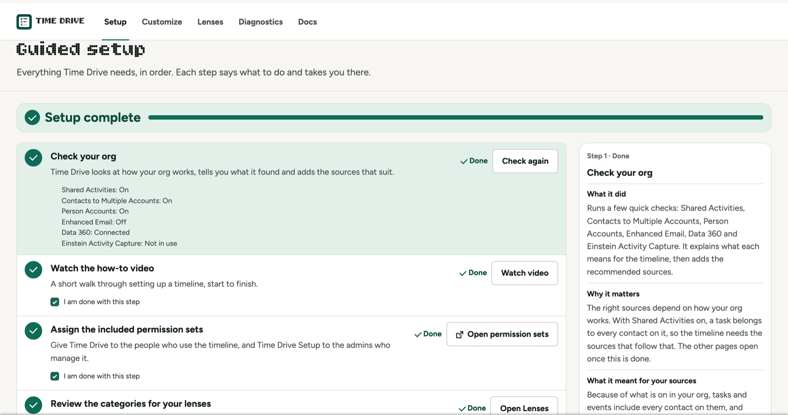

**Check your org** looks at how your org works (Shared Activities, contacts to multiple accounts, person accounts, Enhanced Email, Einstein Activity Capture) and switches on the shipped sources that suit it. See [Fit to your org](#fit-to-your-org).

### Customize

**Customize** lists the record pages Time Drive can be on, each with how many sources it has and how many are active.

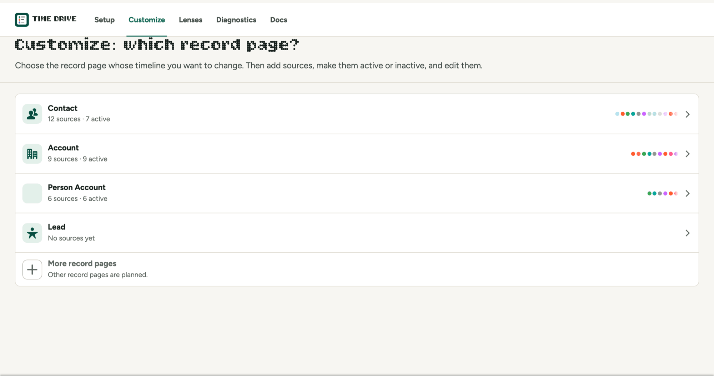

Choose one to see its sources. Each row says what the source plots (its object, how it links to the record and the date it uses) and which lenses it's in. Its switch makes it active or inactive. Filter by kind, or by active and inactive. **Add a source** opens the wizard.

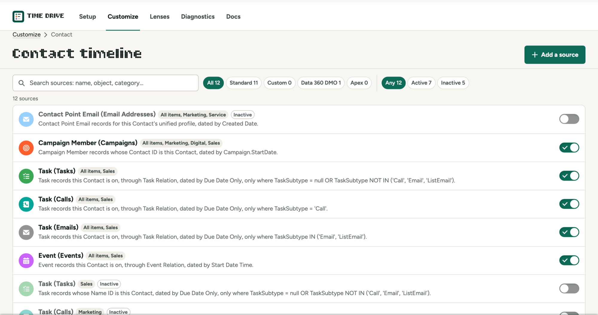

## Add a source

On a record page's sources, choose **Add a source**. The wizard asks one question at a time. **So far**, on the right, collects your answers, and each one is a click away if you want to change it. **Save source** on the last step saves it. Saving takes a few seconds, because sources are custom metadata: see the [FAQs](faqs.md#why-does-saving-take-a-few-seconds).

The first question is where the records come from.

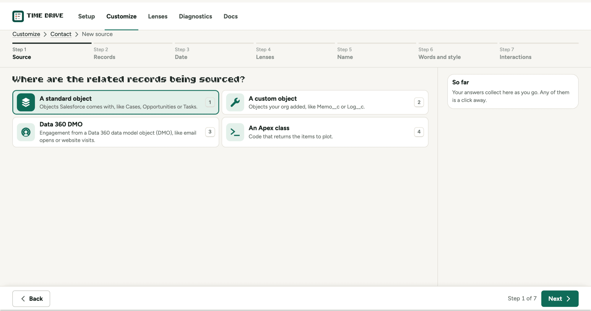

- **A standard object**: objects Salesforce comes with, like Cases, Opportunities or Tasks.
- **A custom object**: objects your org added.
- **Data 360 DMO**: engagement from a Data 360 data model object, like email opens or website visits.
- **An Apex class**: your code returns the items to plot.

### A standard object

This walk-through adds the Contact's cases.

**Step 2, Records.** Search for the object. Only objects that link to the page's record are listed, each with how it links. Choose **Case**, then how cases link to the Contact. Here, **Cases whose Contact (ContactId) is this Contact** is a lookup on the case. You can also show only some records: **Only some** builds conditions, such as Status is Closed.

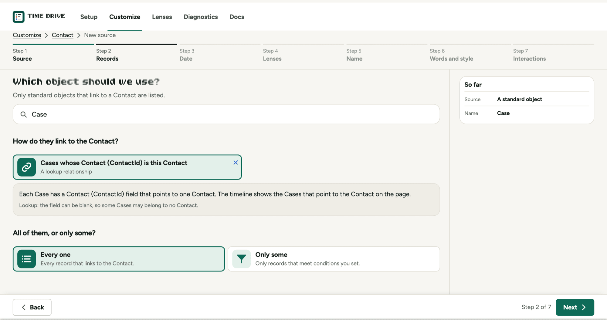

**Step 3, Date.** Choose the date or date/time that places each record on the timeline. Suggested fields come first. A lookup (›) leads to a related record's dates, such as the Account's.

Tasks and Events dated by their usual fields are placed the way Salesforce shows them. A task dated by its **Due Date** (`ActivityDate`) is on its due date, open or done. When it was completed isn't used: Salesforce stamps that at the moment it's saved as done, so logged calls and imported history would all land on the day they were entered. An event dated by its **Start** (`StartDateTime`) is at its start, unless it's all day: then it's on its date, in every time zone. Counts and View all follow the same rules, so a day's count always matches its items. A date (with no time) shows no time, and comes first in its day; in a week or month it shows its day, like everything else.

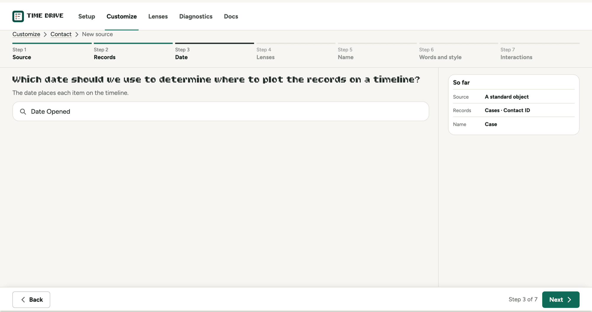

**Step 4, Lenses.** Choose the lenses the items are in. **All items** is where the timeline opens. Leave it out to show these items only in the lenses you choose.

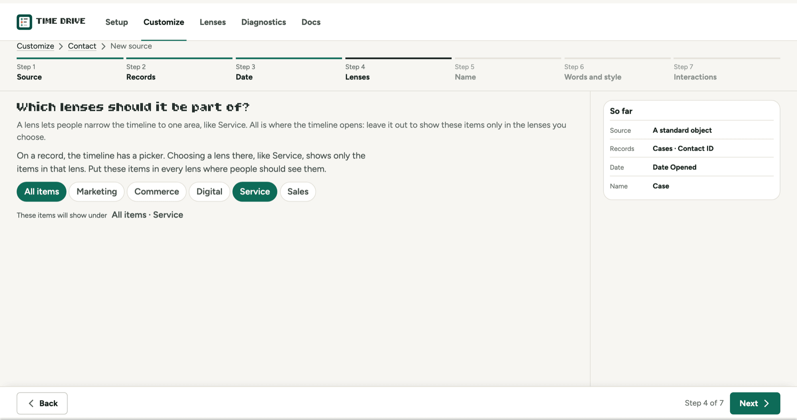

**Step 5, Name.** Choose what the legend and filters call these items:

- **The object's name** ("Cases"), in each person's language.
- **A related object's name**, for a junction.
- **A custom label**, your own words translated into each language.
- **A name you type**, the same for everyone.

On the right, put the source in its place in the legend: drag it, or use the arrows.

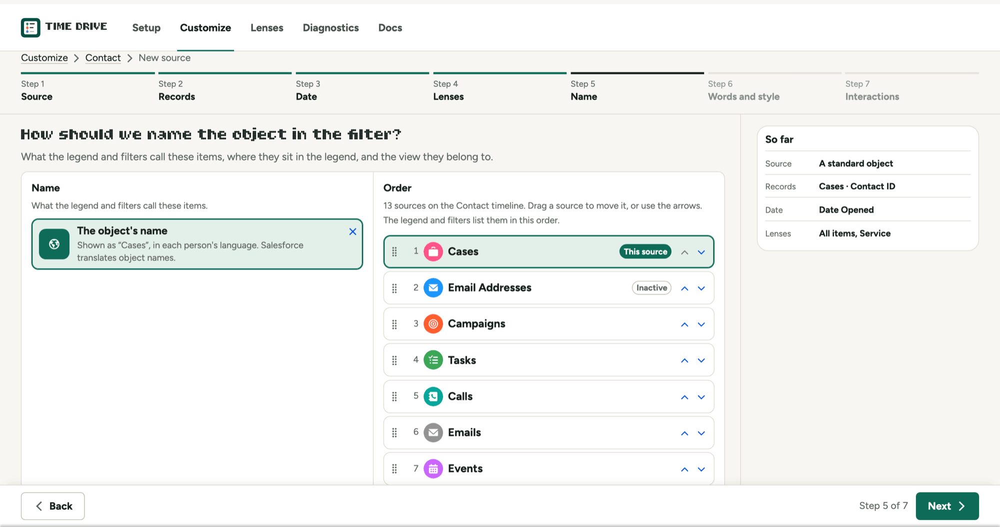

**Step 6, Words and style.** Choose the field each item's title shows (here Subject), up to two fields for its subtitle, and its icon and colour. The subtitle's fields read with a dot between them, and an empty one drops out with its dot: the Tasks, Calls and Events templates show **Assigned To · Related To**. A lookup to more than one object, such as a task's Related To, Name or Assigned To, leads to the record's name and type (`What.Name`) rather than its ID. The preview at the top shows how an item will look.

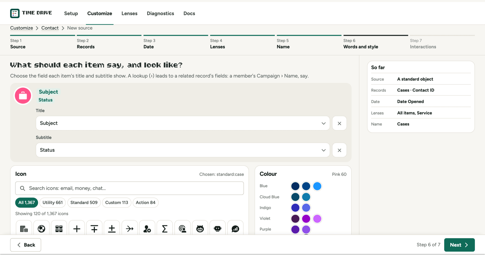

**Step 7, Interactions.** Choose the fields an opened item shows, in order, and how each is formatted. Then choose what clicking its title opens: **Its own record**, or **A related record** (a member's Campaign, say). The preview uses sample values from your data. A **highlight** marks an item with a small icon when a checkbox is checked, such as High priority. The Tasks templates mark overdue tasks with a red clock, using Time Drive's **Overdue** field (see [The Overdue lens](#the-overdue-lens)), and the Cases templates mark escalated cases. For anything else, a formula checkbox of your own works the same way.

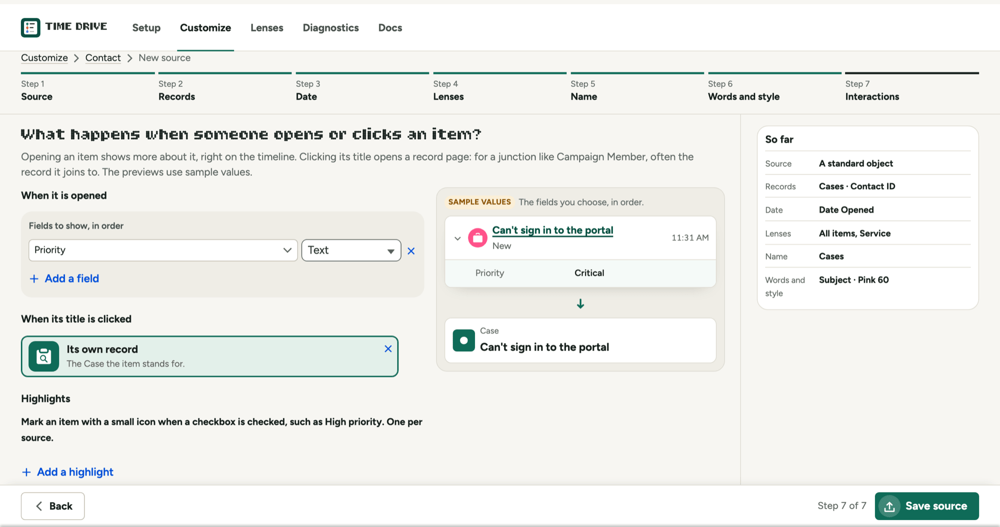

Choose **Save source**. The source is active straight away unless you turn **Active when saved** off.

### A junction object

A junction links records through an object in between: a Contact's cases through **Case Contact Role**, opportunities through **Opportunity Contact Role**, campaigns through **Campaign Member**. Use one when the record you want isn't linked to the page's record directly, or when it can be linked to several.

The steps are the same as for a standard object. The difference is on **step 2**: after choosing the object, choose the option that goes **through** the junction, here **Cases this Contact is on, through Case Contact Role**.

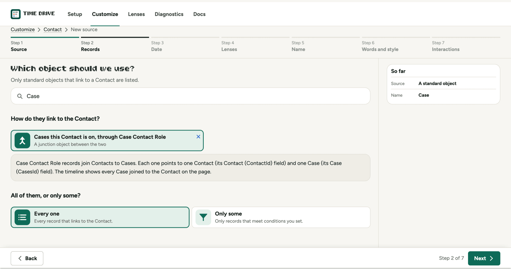

On **step 3** the dates are the case's own: search them, or pick from the list. On **step 5**, **A related object's name** names the items after another object the record links to. On **step 7**, choose whether a click opens the case or a related record.

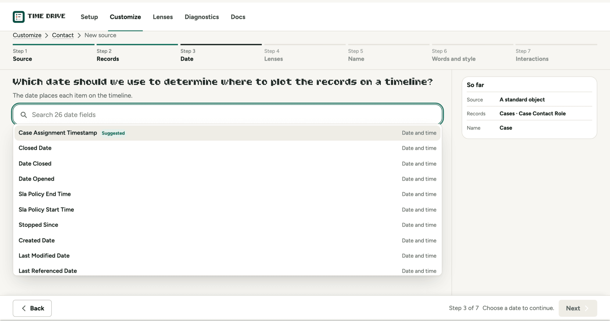

### A custom object

On **step 1** choose **A custom object**. Step 2 lists the custom objects that link to the page's record, each with how it links (a lookup, or through another object).

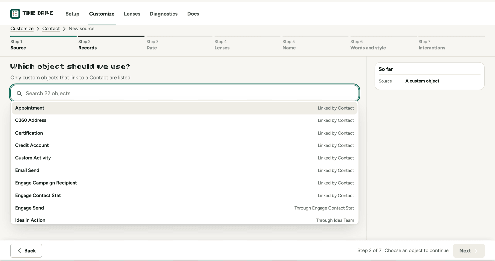

Choose one, then the link. The wizard explains it: here each Appointment has a Contact field that points to one Contact, and it can be blank. **Every one** shows all of them; **Only some** adds conditions.

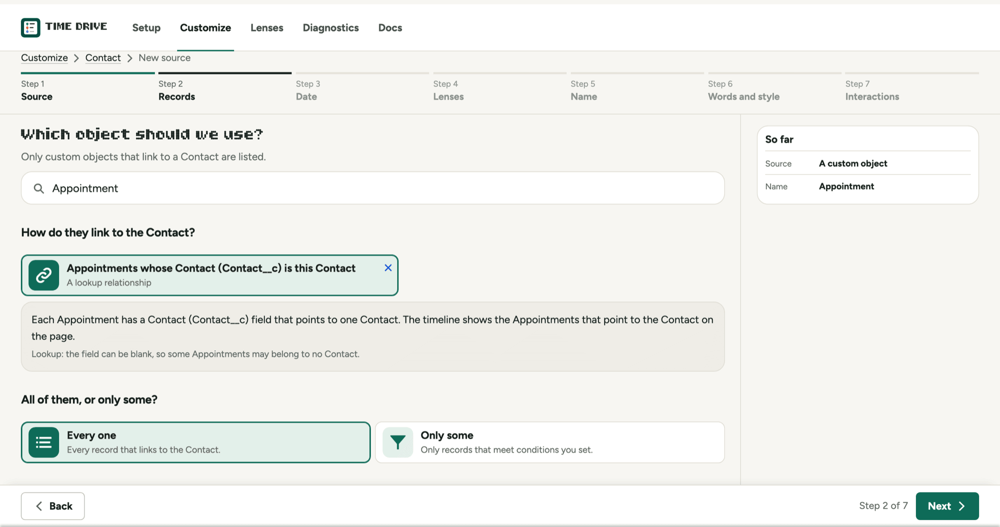

The rest of the steps (date, lenses, name, words and style, interactions) work as for a standard object.

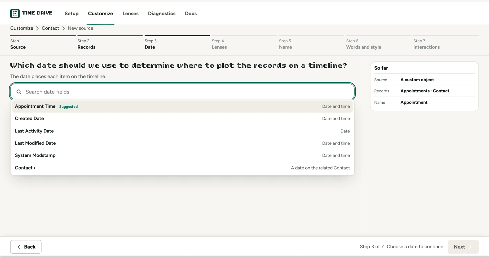

### An Apex class

Use an Apex source for data Setup can't reach with a query: records two or more steps away (an Account's products on all its opportunities), or data from another system. The class extends `TimeDriveApexSource`. See [Apex sources](#apex-sources) for how to write one; Time Drive ships `TimeDriveOpportunityProducts` as an example.

On **step 1** choose **An Apex class**. An Apex source has six steps: the class says how its rows are dated and titled, so the wizard doesn't ask.

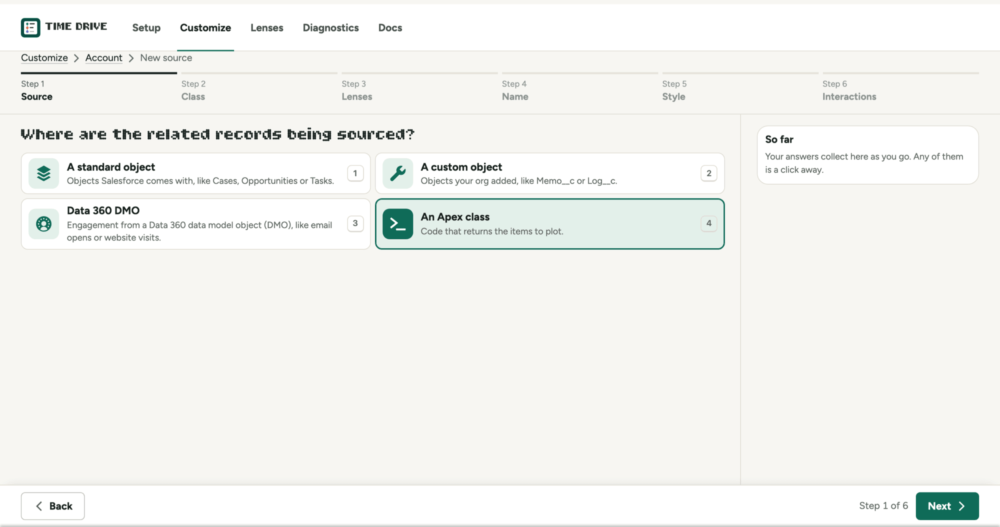

**Step 2, Class.** Choose the class. Only classes that extend `TimeDriveApexSource` are listed.

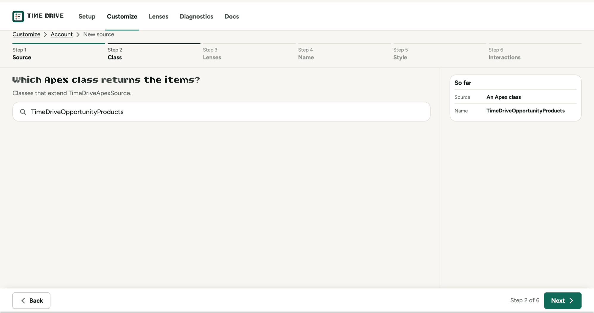

**Step 3, Lenses**, as for any source.

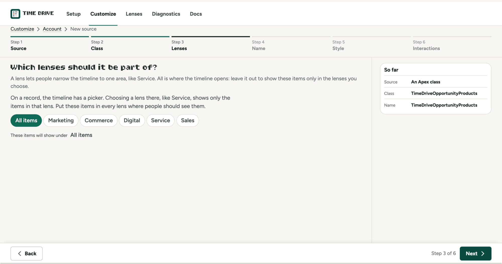

**Step 4, Name.** A custom label, or a name you type. The class's name is filled in to start with.

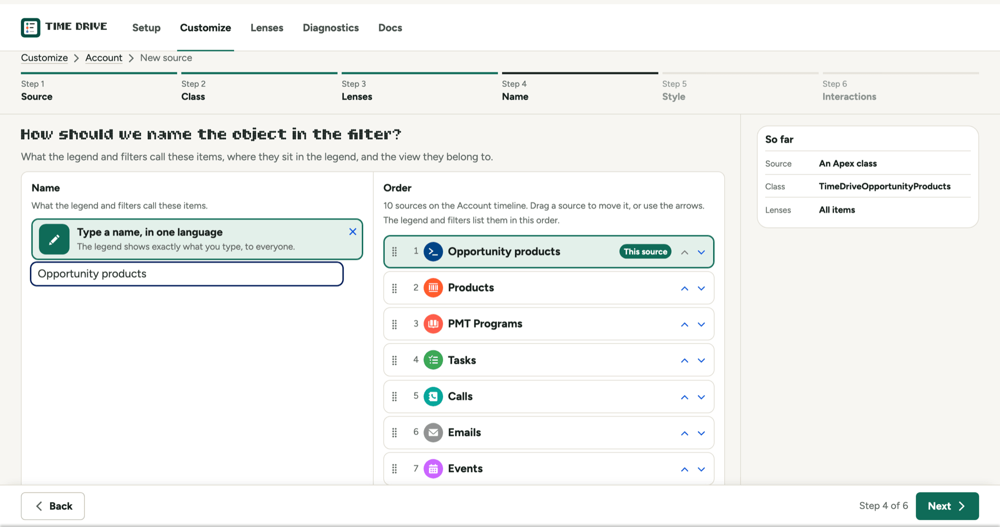

**Step 5, Style.** The icon and colour.

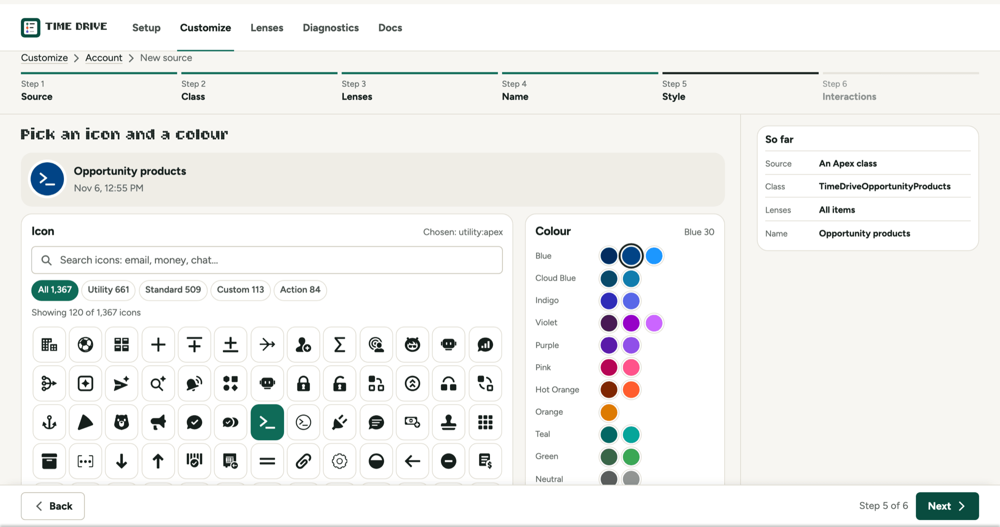

**Step 6, Interactions.** The fields an opened item shows: a field path for record rows (`Product2.Name`), or a map key for rows from elsewhere. Saving asks you to confirm you've thought about how the class scales, because it runs every time a timeline with the source loads.

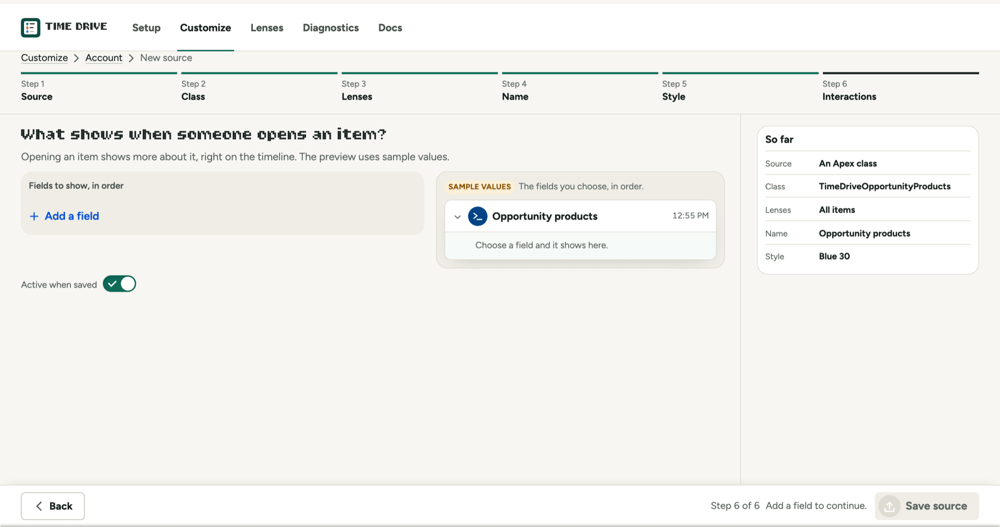

### A Data 360 DMO

On **step 1** choose **Data 360 DMO**, then on step 2 the data space and the engagement DMO, and which of its fields holds the individual. Data 360 finds the Contact's unified profile, then reads the engagement of every individual in it. See [Data 360 sources](#data-360-sources) for what to check before going live. Screenshots of this path are still to come.

## Lenses

A lens narrows the timeline to one area, such as Sales or Service. People switch lenses from the timeline's heading, and Time Drive remembers their choice in the org.

**Time Drive Setup > Lenses** shows every source of a record page against every lens: tick the lenses each source is in. A switch over a lens turns it on or off for everyone.

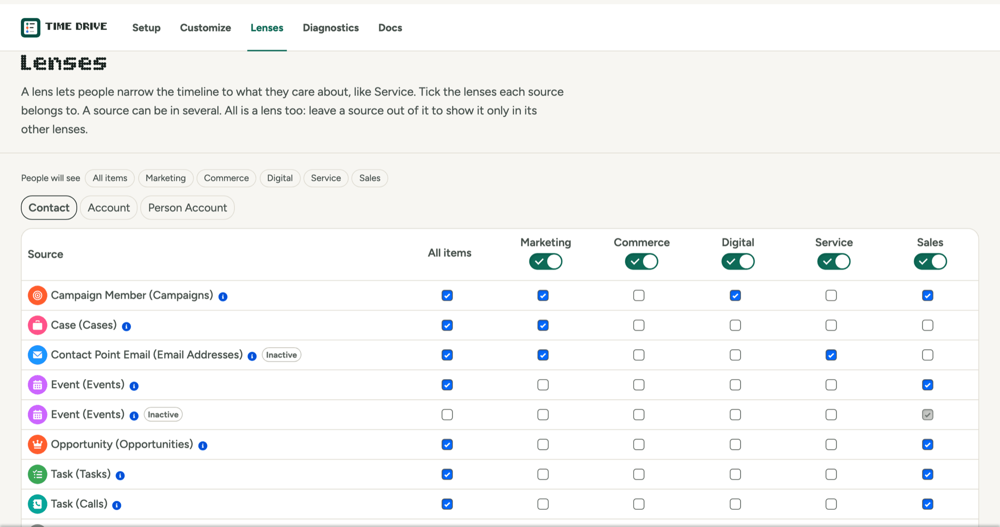

- **All items** is a lens like any other. It's where the timeline opens unless the page says otherwise.
- A source can be in several lenses. Leave a source out of All items to show it only in the lenses you choose.
- The ⓘ next to a source shows the filter it applies, so you can see what each one plots.

### The Overdue lens

The **Overdue** lens shows what's late. Time Drive doesn't decide what counts as overdue: its sources do, each with its own filter. The overdue templates (**Overdue tasks**, and the Fit to your org variants for Account, Contact, Lead and person account pages) plot tasks whose **Overdue** field is checked (`Overdue__c = true`). Add any source to the Overdue lens with a filter of your own, such as open cases older than a week, and it counts too.

**The Overdue field.** Time Drive adds one formula checkbox to Activity, **Overdue** (`Overdue__c`): an open task whose due date is before today, in the viewing person's own day (`AND(NOT(IsClosed), NOT(ISBLANK(ActivityDate)), ActivityDate < TODAY())`). The Tasks templates' highlight and the overdue templates' filter both use it. Its formula is part of the package, so it can't be edited; for other rules (overdue after three days, or by status), make a formula checkbox of your own and choose it in the source's Highlights, or use it in the source's filter. The **Time Drive** and **Time Drive Setup** permission sets let people read it.

- An overdue template's copy is in the Overdue lens only: its tasks are in All items already.
- Once the timeline has loaded, it asks whether the Overdue lens has anything for the record. If it does, a red **Overdue** button appears beside **Today**; clicking it opens the Overdue lens. On the Overdue lens the button shows pressed, and clicking it again goes back to the lens you came from.
- The question is cheap: one query per object, asking for a single row, stopping at the first that finds one. Ten overdue sources on Task are one query, not ten.
- The button finds the lens by its API name, `Overdue`, so you can rename or translate the lens's label freely. Turn the lens off and the button goes too.

## Add the timeline to a page

Open a Contact, Account or Lead record, choose **Edit Page**, and drag **Time Drive** onto the page (it's under custom components). Time Drive Setup's last guided step takes you there. These properties can be set in Lightning App Builder:

- **Title** (default Time Drive): the timeline's name for screen readers. The lens's name is the visible heading.
- **Layout** (default Auto): Auto is vertical in narrow regions and horizontal from 640px wide. Vertical or Horizontal pins one.
- **Default Lens** (default All): the lens the timeline opens on. People can still pick another from the heading; a lens the org doesn't offer opens on All.
- **Lenses** (blank: every lens): the lenses this page offers, by API name, separated by commas (`Sales, Service`), so an Account page can offer different lenses from a Contact page. **All items** and **Overdue** are always offered. A Default Lens, or a lens someone last used, that the page doesn't offer opens on All.
- **Open At** (default Today): today's slot (with a placeholder when it has nothing), the earliest item, or the latest.
- **Display Density** (default Auto): Auto follows each user's Comfy or Compact setting; Comfy or Compact overrides it.
- **History (years)** (default 1): how far back it plots, from 0.25 to 10 years.
- **Future (years)** (default 0.5): how far ahead it plots future-dated records (scheduled orders, close dates). None is up to today; otherwise 0.25 to 10 years.
- **Let People Narrow the Date Range** (default on): Filters offers **Back** and **Ahead**, how far either side of today to show (None, 1 month, 3 months, 6 months, 1 year, 2 years ...), each up to History or Future. Each person's choice is kept with their other preferences and shows as a chip in the header ("3 months back · 1 month ahead"); its x goes back to History and Future. A kept range longer than a page allows is trimmed to it there. Off: everyone sees History to Future.
- **Vertical Mode Height (px)** (default 560, 320 to 1600): the list's greatest height. Past it, items scroll inside.
- **Horizontal Mode Height (px)** (default 260, 240 to 1000): the day columns' height. Busier days scroll inside their column.

## Reference

The sections below explain what Setup does for you, and what you can change by hand.

## Fit to your org

**Time Drive Setup > Fit to your org** checks which features the org uses (Shared Activities, person accounts, contacts to multiple accounts) and switches on the shipped sources that suit it. Alternatives share a group, and only one in a group is ever active, so running it again never plots the same record twice.

#### Account pages and shared activities

An account's activities come from `Task.AccountId` and `Event.AccountId`, the field the standard timeline rolls up by: the account's own, its contacts', and those of its opportunities and contracts. An activity shared with a second contact (Shared Activities) carries another account's Id there.

So with Shared Activities in use, Fit to your org switches each of Tasks, Calls, Emails and Events to its `_Every` variant (`Fit_Account_Tasks_Every` and so on). That's one query through `TaskRelation.AccountId` or `EventRelation.AccountId`, returning the account's own activities and the shared ones together. Without Shared Activities the main sources stay.

Cases with no contact aren't part of the standard rollup either. A custom object joins an Account page through the field that holds the account (the wizard asks "Which field holds the account?").

## Source fields

Each Time Drive Source record has these fields. Setup fills them in; you can also edit them in Setup > Custom Metadata Types > Time Drive Source > Manage Records.

- `Active__c`, `Sequence__c`: plot it or not, and the order sources run in.
- `Kind__c`: Salesforce, Data 360 or Apex.
- `Parent_Object__c`: the record page it serves (`Contact`).
- `Provider_Class__c`: for Kind Apex, a class extending `TimeDriveApexSource`.
- `Object_Name__c`: Salesforce, the object; Data 360, the DMO; Apex, a name for the footer ("Loyalty").
- `Parent_Field__c`: Salesforce, how records link to the page's record (`ContactId`).
- `Junction_Object__c`, `Junction_Parent_Field__c`, `Junction_Record_Field__c`: Salesforce, indirect links such as `OpportunityContactRole`, `ContactId` and `OpportunityId`.
- `Individual_Field__c`, `Data_Space__c`: Data 360, the DMO's Individual Id field (`ssot__IndividualId__c`) and its data space.
- `Date_Field__c`, `Filter__c`: the date or date/time to plot by, and an optional SOQL condition (`IsClosed = true`). Setup's builder writes conditions that must all hold (AND) or any of which may (OR), with "is one of" for picklists (`IN`). A filter that mixes AND and OR, or uses anything else, shows as fixed text.
- `Id_Field__c`: unique per event. Blank: `Id` (`ssot__Id__c` for Data 360 DMOs that have it).
- `Record_Id_Field__c`: a Salesforce record Id to link to and expand. Blank: `Id` for Salesforce, none otherwise.
- `Title__c`, `Subtitle__c`: templates with `{Field}` tokens, relationships included (`{Subject}`, `{Account.Name}`).
- `Event_Type__c`, `Event_Label__c`, `Category__c`: the type key (filters, grouping), its legend name ("Case updates", or a `$Label.Name` to translate), and its default lens.
- `Lenses__c`: the lenses it's in, separated by semicolons (`Sales;Service`). Blank: Category is its one lens.
- `Icon__c`, `Icon_Colour__c`: an SLDS icon (`utility:case`, `standard:case`) and its background colour (`#1F7A8C`).
- `History_Months__c`: how far back this source plots, when that's less than the timeline's own History.
- `Max_Records__c`: a per-source cap, newest first (default 1000), for sources that are read rather than counted.
- `Org_Fit__c`, `Requires__c`, `Variant_Group__c`, `Removed__c`: set by Time Drive Setup. Shipped sources Fit to your org turns on, the org features each needs, alternatives of which only one is active, and sources removed in Setup.

## Expanding records

An event expands with its source's **Time Drive Detail Field** records: Source, Field, Label, Sequence, and Format (Text, Date, Date/Time, Currency or Number). These are the fields you chose in the wizard.

- A blank label uses the field's own label, in the user's language.
- A label can be a custom label (`$Label.Points`), to translate it.
- A detail that names a record links to it, opened as the title is (a workspace tab in Console apps): a field through a lookup, such as a task's **Related To › Name** or **Account › Account Name**, links to that record, and a lookup chosen as itself links to the record it holds. Plain values stay words. The record's Id is read with the item, so a link costs nothing more.
- An event with no detail fields opens on its title, subtitle and source alone.

## Data 360 sources

Each engagement DMO is its own Time Drive Source of Kind **Data 360**. The shipped ones are `Data_360_Email`, `_Message`, `_Website`, `_Web_Search`, `_App` and `_Cart`:

- Email sent, opened and clicked: `ssot__EmailEngagement__dlm`
- Push and SMS: `ssot__MessageEngagement__dlm`
- Website page views: `ssot__WebsiteEngagement__dlm`
- Web searches: `ssot__WebSearchEngagement__dlm`
- App sessions and screens: `ssot__DeviceApplicationEngagement__dlm`
- Add to cart and abandoned carts: `ssot__ShoppingCartEngagement__dlm`

To find a person's engagement, the Data 360 provider:

1. Treats the Contact Id as an Individual Id (the Sales Cloud connector maps Contact to `ssot__Individual__dlm`).
2. Finds the Unified Individual through the identity link DMO, then every source Individual merged into it (web, app, Marketing Cloud subscriber).
3. Queries the source's DMO in user mode for those Individuals and the days asked for.

Check these before you go live:

- **Identity link object.** Set it in **Time Drive Setting > Default** to your ruleset's link DMO (Data Cloud Setup > Data Model), for example `UnifiedLinkssotIndividualTimeDrive__dlm`. If the one set (default `IndividualIdentityLink__dlm`) isn't there, the ruleset's `UnifiedLinkssotIndividual…__dlm` is used, with `SourceRecordId__c` and `UnifiedRecordId__c`.
- **Fields.** Check each source's Object Name, Individual Field, Date Field, Id Field and templates against your mappings.
- **Details.** Each DMO's expanded fields are its detail fields (shipped: Channel action).
- **Access.** Users need read access to the DMOs (a Data Cloud permission set) in the data space they live in.
- **Counting.** Deploy `force-app-data360` too: it counts each DMO in Data 360 SQL, so the day list, overview and totals cover every engagement record. Without it, or if a count's SQL isn't accepted, each DMO is read as rows, up to Max Records, with a warning when that cuts it short.
- **Volume.** Rows are only read for the days on screen, and a busy day comes back as grouped counts. For very heavy histories, a calculated insight that pre-aggregates per day is still the cheapest summary.

Anything missing or unreadable shows as a warning on the timeline instead of an error, and the CRM events still load.

## Apex sources

Most sources need no code. Write an Apex source when Setup can't reach the data:

- **Records further away**, such as an Account's products on all its opportunities, two steps from the page.
- **Data from elsewhere**, such as an external system, a calculation or a forecast.

A source class extends `TimeDriveApexSource`. Time Drive asks it two things, and it answers each its own way:

- `rows(context)` (required): the items on the days in `context.spans()`. For a source that counts, that's only ever the days on screen, a few at a time.
- `counts(context, unit)` (optional): how many items each period of the window has, for the summary (the day list, overview and counts).

A source that counts covers any amount of history: the summary takes only its counts, and a busy day shows as one grouped row from its count. A source that doesn't count (leave `counts` out, or return null) is read in full for the summary, up to its Max Records, and the timeline says so when it reaches them. That's fine for a short history; anything that can grow should count.

### Say how to plot the rows

`rows` returns a `TimeDriveRow` for each item: a record (`new TimeDriveRow(record)`) or a map of values (`new TimeDriveRow(map)`). First thing in `rows`, say how to plot them:

```apex
context.plotBy('EarnedAt')               // the key holding each item's Date or Datetime
  .title('Earned {Points} points')       // {Key} is filled from each row
  .subtitle('{Reason}')                  // optional
  .opens('OrderId')                      // optional: the key holding the Salesforce record a click opens
  .links('Customer', 'CustomerId');      // optional: a detail's record, so the opened item links it
```

Setup doesn't ask an Apex source for these, so without `plotBy` nothing is plotted. A key is a field path for record rows (`Product2.Name`) or a map key for value rows (`Points`). Everything else (icon, colour, lenses, the legend name and the fields an opened item shows) is chosen in Setup.

`links(detailKey, recordIdKey)` makes a detail a link: the detail chosen in Setup as `detailKey` opens the Salesforce record whose Id is in `recordIdKey`. Call it once for each detail that names a record. Record rows don't need it for a path through a lookup: `Product2.Name` links to `Product2.Id` by itself, since `fieldsToQuery` asks for it.

`opens` decides whether an item's title is a link. Call it when each row holds a Salesforce record to open. Leave it out when there's nothing to open (a weather forecast, an external system's entries): the title is plain text, with no link and no Edit or Delete menu. Such items also can't be highlighted or listed in View all.

### Count the items

`counts` returns a `TimeDriveContext.DayCount` for each period with items. Count by the period asked for (`unit`: hour, day, week or month) or by any shorter one: Time Drive adds daily totals up into weeks or months, and a day's total when asked by hour makes a busy day one grouped row. Counts outside the days asked for are left out. Two helpers build them:

- `context.countBy(objectType, dateField, condition, binds, unit)` for records: the condition that finds this record's items, written once. Time Drive groups them by the period in one query, in the user's time zone, in user mode, within the platform's limits.
- `context.counter(unit)` for data from elsewhere: `add(moment)` for each item, or `add(day, count)` for a day's total, then `counts()`.

### Records a query can reach

`TimeDriveOpportunityProducts` is the shipped example. It plots an Account's products on all its opportunities, and a click opens the Opportunity Product:

```apex
public with sharing class TimeDriveOpportunityProducts extends TimeDriveApexSource {
  private static final String CLOSE_DATE = 'Opportunity.CloseDate';
  private static final String THIS_ACCOUNT = 'Opportunity.AccountId = :accountId';

  public override List<TimeDriveContext.DayCount> counts(TimeDriveContext context, String unit) {
    if (context.recordId?.getSObjectType() != Account.SObjectType) {
      return new List<TimeDriveContext.DayCount>();
    }
    return context.countBy(
      OpportunityLineItem.SObjectType,
      CLOSE_DATE,
      THIS_ACCOUNT,
      new Map<String, Object>{ 'accountId' => context.recordId },
      unit
    );
  }

  public override List<TimeDriveRow> rows(TimeDriveContext context) {
    List<TimeDriveRow> rows = new List<TimeDriveRow>();
    if (context.recordId?.getSObjectType() != Account.SObjectType) {
      return rows;
    }
    context.plotBy(CLOSE_DATE).title('{Product2.Name}').subtitle('{Opportunity.Name}').opens('Id');
    Map<String, Object> binds = new Map<String, Object>{
      'accountId' => context.recordId,
      'most' => context.maxRecords()
    };
    String soql =
      'SELECT ' +
      String.join(context.fieldsToQuery(new List<String>{ 'Id', CLOSE_DATE }), ', ') +
      ' FROM OpportunityLineItem WHERE ' +
      THIS_ACCOUNT +
      context.dateCondition(OpportunityLineItem.SObjectType, CLOSE_DATE, binds) +
      ' ORDER BY ' +
      CLOSE_DATE +
      ' DESC, Id DESC LIMIT :most';
    for (SObject item : Database.queryWithBinds(soql, binds, AccessLevel.USER_MODE)) {
      rows.add(new TimeDriveRow(item));
    }
    return rows;
  }
}
```

- `countBy` and `rows` share the condition, so the counts and the items always agree.
- `fieldsToQuery` adds the fields your title, subtitle and the source's detail fields name, so whatever an admin chooses in Setup is read.
- `dateCondition` keeps the query to the days the timeline asks for. It works out whether the field is a Date or a Date/Time.

### Data from elsewhere

Each row is a map, and its keys are what the title, subtitle and detail fields name. Give every row a unique `Id` key. Ask the service only for the days in `context.spans()`, and return only the items `context.wants`:

```apex
public with sharing class MyLoyaltySource extends TimeDriveApexSource {
  // The summary: one call for the window's daily totals.
  public override List<TimeDriveContext.DayCount> counts(TimeDriveContext context, String unit) {
    TimeDriveContext.Counter counter = context.counter(unit);
    for (LoyaltyApi.Total total : LoyaltyApi.dailyTotals(context.recordId, context.since, context.until)) {
      counter.add(total.day, total.entries);
    }
    return counter.counts();
  }

  // The days on screen.
  public override List<TimeDriveRow> rows(TimeDriveContext context) {
    context.plotBy('EarnedAt').title('Earned {Points} points').subtitle('{Reason}');
    List<TimeDriveRow> rows = new List<TimeDriveRow>();
    for (TimeDriveController.TimeWindow span : context.spans()) {
      for (LoyaltyApi.Entry entry : LoyaltyApi.entriesFor(context.recordId, span.since, span.until)) {
        if (context.wants(entry.earnedAt)) {
          rows.add(
            new TimeDriveRow(
              new Map<String, Object>{
                'Id' => entry.id,
                'EarnedAt' => entry.earnedAt, // a Datetime or a Date
                'Points' => entry.points,
                'Reason' => entry.reason
              }
            )
          );
        }
      }
    }
    return rows;
  }
}
```

How you count is yours to choose: a totals endpoint, as here; a cached copy; or counting the items of one fetch with `counter.add(entry.earnedAt)`. If the service can't help at all, leave `counts` out.

### What context gives you

- `recordId`: the record the timeline is on.
- `since`, `until`: the timeline's window. `until` is null for "up to now".
- `spans()`: the days asked for, either the window or the days on screen.
- `maxRecords()`: the source's record cap.
- `plotBy(key).title(…).subtitle(…).opens(…).links(…)`: how the rows are plotted, and which details link to records.
- `fieldsToQuery(always)`: for record rows, the fields to SELECT.
- `dateCondition(objectType, field, binds)`: for record rows, the days asked for as a bound condition.
- `wants(dateOrDatetime)`: for data from elsewhere, whether the timeline asks for that moment.
- `countBy(objectType, field, condition, binds, unit)`: counts of records, grouped by the period in one query.
- `counter(unit)`: counts of items from elsewhere, added one at a time or by the day.
- `warn(message)`: a note the timeline shows, such as "Couldn't reach the loyalty service".

### Good practice

- **Count anything that can grow.** Without `counts`, every timeline load reads the source's whole window.
- **Query in user mode** (`AccessLevel.USER_MODE`), so people see only what they're allowed to.
- **Cache callouts.** The summary and each page are their own requests. Keep what a callout returns in Platform Cache (`TimeDriveCache`) for a while, so a page view doesn't call out several times. Set a short callout timeout.
- **Failures are contained.** A class that throws is named on the timeline, and the other sources still load. A `counts` that throws is read as rows instead. Prefer `warn` for problems you expect.

### Time zones and translations

The timeline shows every date, time and number in the viewer's own time zone, language and locale. Your rows get the same treatment as Setup's sources, as long as you hand over real values rather than text:

- **Dates and times.** Give a `Datetime` for a moment and a `Date` for a whole day (a day plots at midday, so it stays on its day in every time zone). Text works too, as a service's JSON gives it: `2026-10-31` is a day, and `2026-10-31T09:00:00Z` or `2026-10-31T20:00:00+11:00` is that moment (text with no zone is read as the user's own time). An item whose date can't be read is left out, and the timeline says how many.
- **Numbers and money.** Give numbers as numbers (`Decimal`, `Integer`, `Double`), not formatted strings. They show grouped as the viewer's locale does (1,200.5 or 1.200,5). A detail field with the Currency format shows in the viewer's currency, or in a row's own when it has a `CurrencyIsoCode` key (records have it in multi-currency orgs; add it to the fields you query).
- **Picklists** on records show their labels in the viewer's language.
- **Words you write.** Text in `title` and `subtitle` is shown as you wrote it. For translated text, pass a custom label: `.title(System.Label.Points_Earned)`, whose text can hold tokens such as `{Points}`. A detail field's label can be `$Label.Points` too.
- **Text from elsewhere.** Ask the service for the viewer's language (`UserInfo.getLanguage()`, `UserInfo.getLocale()`) where it supports one.

### Test and add it

1. Test the class to at least 85%. Give it test data or an `HttpCalloutMock`, call `rows` and `counts` with a context for the record and window you want (`new TimeDriveContext(recordId, since, until)`), and check what they return.
2. In Time Drive Setup, add a source of kind **Apex** on the record page and choose the class. Pick its look and lenses, then type the fields an opened item shows: a field path, or a map key.
3. Saving asks you to confirm you've thought about how the class scales, because it runs every time a timeline with the source loads.

## How people use the timeline

#### Layout

- **Vertical** in narrow regions: newest first, grouped by day, one coloured node per event. Click a row (or **Expand all**) for its details and source object. The list is up to Vertical Mode Height tall and scrolls inside the card; loading, empty and error states keep that height, so nothing jumps.
- **Scrub tab.** From two weeks of active days a scrub tab rides the vertical list's edge. Grab it and an overlay opens with the whole history as heat bars, with a bubble naming the day and month (or month and year) under your finger. Let go to jump there. Focus the tab for the arrow, Page and Home/End keys.
- **Scrolling.** Wheel and touch over the list scroll the page until you click (or tap) inside it; then they scroll the list until the pointer leaves the card. A faint ring shows it's engaged, and a hint shows the first time the wheel passes over it. A week of days draws from where you land, and more load as you scroll (up to four weeks drawn at once).
- **Horizontal** once the card is 640px wide or more: each day is a column along a time axis. From two weeks of active days a **seek bar** runs under the columns. Grab it and an overlay shows the whole history as heat bars; the columns follow the pointer, and a click glides to a day.
- **Phone.** In the Salesforce mobile app on a phone the card is always the vertical list and fits the screen. It starts in Lite (titles only; the button after Today shows times and dates), has larger tap targets, a one-line header (Today, Filters and a ⋯ menu holding Refresh, Expand all and the Lite switch), and no activity buttons.

The header carries the lens as its heading with **Today** (and **Overdue**, while something is) at the end of its line; under it, the summary, with **Filters** (event types) and **Refresh** at the end. Each user's lens and Lite choice are kept for them in the org.

Busy days (over 50 events of a type) show one grouped row per type, its icon drawn as a stack. For Salesforce sources its title links to all its items (View all). Every event's detail names the object it came from.

#### Long histories

History and Future reach up to ten years either way. The overlays keep their bars readable however long the span: one bar per active day while they fit, then one per week, month, quarter or year, the finest that fits. Long spans label years; shorter ones label months.

#### Language and direction

Dates follow the user's Salesforce **locale** and **time zone**: day headers, months and years, "Today" and "Yesterday", and event times on that locale's clock. Numbers and money follow the locale too, money in each record's own currency in multi-currency orgs.

In right-to-left languages (Arabic, Hebrew, Farsi, Urdu) the card mirrors: text, icons and rows read right to left, the scrub tab sits on the left edge, and panels open from the left. The horizontal time axis and its seek bar keep time running left to right, as charts do.

## Scale

The summary counts each source rather than reading it: an aggregate query per Salesforce object (a query row per day, not per record), SQL per Data 360 object, and `counts` for Apex sources.

- When History and Future make the window too long to count every source by day within 30,000 query rows, it counts by week (from 1 January: the 1st-7th, 8th-14th ...) or by month, and the list shows weeks or months.
- Rows are read only for the days (or weeks) on screen.
- A busy day (over 50 items) isn't read at all; it comes back as grouped counts.
- The sources are kept in Platform Cache for 10 minutes, and each Data 360 identity lookup for 15, once the **TimeDrive** partition has capacity (see [Allocate Platform Cache](#allocate-platform-cache)). Saving in Setup clears the sources at once; changes made another way (Data Loader, Apex) show within 10 minutes.

## Translations

The timeline's text (the card, its filters, the View all page, record details and error messages) is custom labels (`Time_Drive_*`), in English with translations into Spanish, Arabic, Danish, Finnish, French, German, Japanese, Korean, Swedish, and Chinese Simplified and Traditional. Setup's own text is English for now.

> [!IMPORTANT]
> Make each language **Active** in Setup > **Translation Language Settings** (turn on Translation Workbench first). The card's own labels show their translation either way, but Salesforce only translates the labels Apex reads once the language is Active: until then, warnings, Yes and No, and your own `$Label` names stay in English. Salesforce's own field and picklist names need it too.

- To review or change a translation, open Setup > **Custom Labels** (you need the Manage Translation permission).
- To see a language, set a user's language to it.
- The translations are drafts: have a native speaker review them. Arabic has singular, dual and plural forms; each count here uses one plural form.

For developers: `scripts/labels/catalogue.py` is the list of strings (a key, the English, the Spanish and the Arabic); each other language has its own file, by key (`scripts/labels/fr.py` and so on). Add or change a string there, then run `python3 -I scripts/labels/generate.py`. It writes `CustomLabels`, the translation files and the shared `c/timeDriveLabels` module, and stops if a language misses a string or its `{0}`, `{1}` ... differ from the English. Fill in `{0}`, `{1}` ... with `format(LABELS.itemsMany, 12)`. In Jest the labels read as their English text.

## Sample data

Cases and Opportunities are plotted from the Contact's real records (cases by `ContactId`; opportunities by `ContactId` or an Opportunity Contact Role). To seed a few on the three Contacts with the most cases:

```
sf apex run --file scripts/apex/seed-timeline-samples.apex --target-org <alias>
```

Every seeded record's Description starts with `[Timeline sample]`.

To see a long quiet stretch, `scripts/apex/seed-two-year-sample.apex` adds a Contact, **Riley Span**, with two tasks two years apart (tagged `[Two-year sample]`). Set History to 2 years or more to plot the older one.

---

Questions? Read the [FAQs](faqs.md), or go back to [Before you start](#before-you-start).
